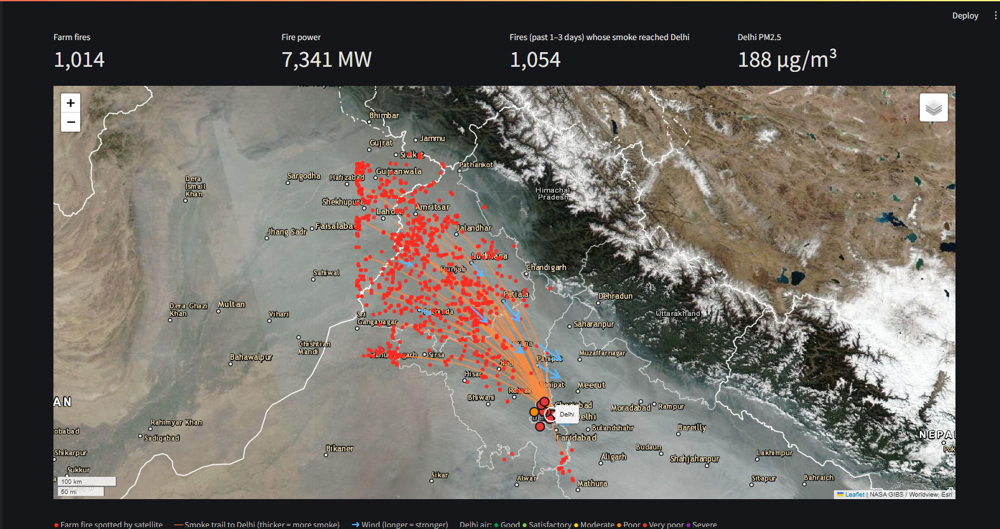
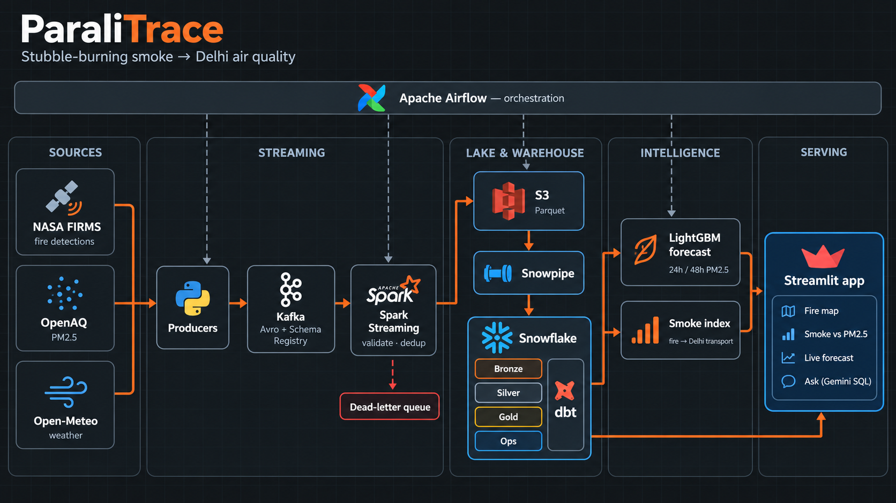
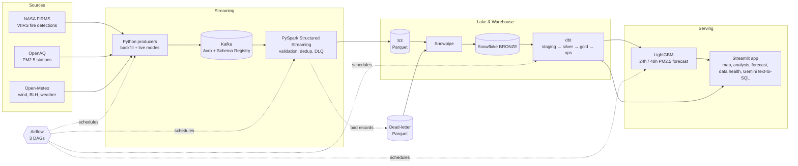
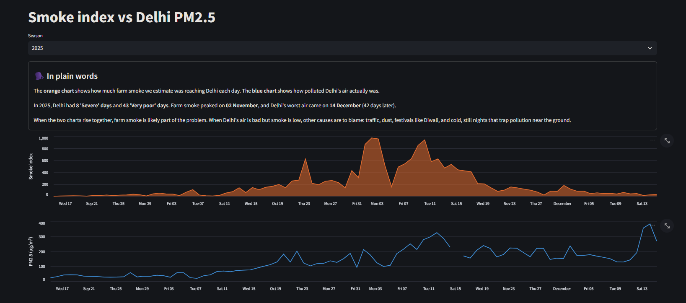
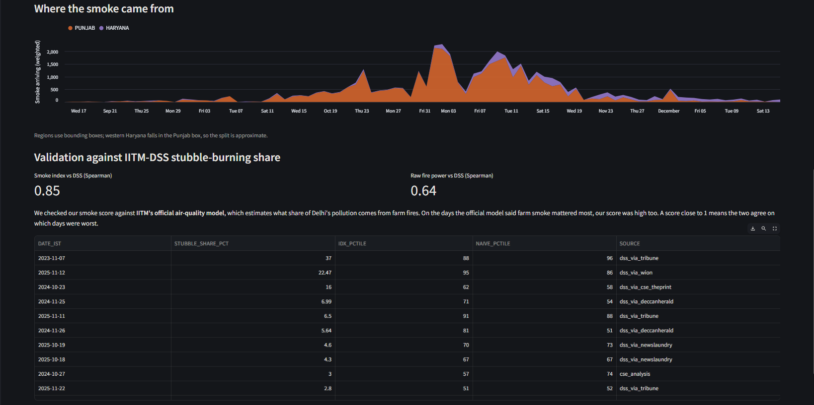
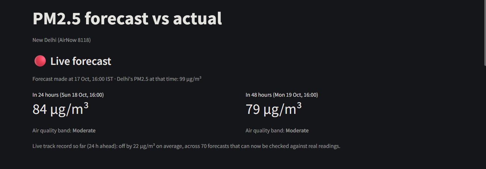
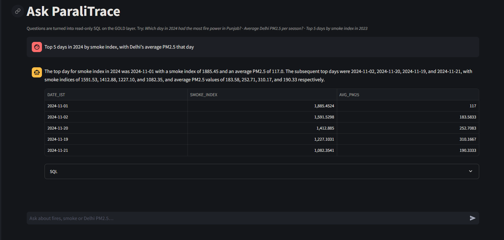

# ParaliTrace

**Tracing stubble-burning smoke from Punjab and Haryana to Delhi's air: streaming ingestion, a dimensional warehouse, a wind-based smoke index, a PM2.5 forecast, and a live pipeline orchestrated end to end.**



Every October and November, farmers in Punjab and Haryana burn leftover rice straw ("parali") to clear their fields, and Delhi's air turns hazardous. How much of that smog actually comes from the fires depends on the wind each day. ParaliTrace joins NASA satellite fire detections, hourly weather and Delhi air-quality readings to estimate how much smoke is heading for Delhi at any hour, and forecasts Delhi's PM2.5 24 and 48 hours ahead.

### Three seasons at a glance

| Season | Farm fires detected | Total fire power | Delhi average PM2.5 |
|---|---:|---:|---:|
| 2023 | 75,405 | 487 GW | 141 µg/m³ (2.3× safe limit) |
| 2024 | 50,613 | 285 GW | 142 µg/m³ (2.4× safe limit) |
| 2025 | 28,911 | 160 GW | 133 µg/m³ (2.2× safe limit) |

Fire power dropped about **67%** between 2023 and 2025, but Delhi's air barely improved. Farm fires are one cause among several: traffic, dust, industry and cold, still winter air matter too.

---

## Architecture



<details>
<summary>Detailed flow (Mermaid)</summary>



</details>

| Layer | Tech | What it does |
|---|---|---|
| Ingestion | Python, `confluent-kafka` | Producers for fires, AQ and weather. `backfill` replays past seasons; `live` pulls recent windows. Idempotent producers, Avro schemas in Schema Registry. |
| Stream processing | PySpark 4 Structured Streaming | Avro decode, schema and range validation, watermark dedup, bad records routed to a dead-letter queue with an `error_reason`. |
| Lake | S3 (Parquet) | Clean and DLQ outputs, partitioned by source. |
| Load | Snowpipe | Auto-ingest from S3 into `BRONZE` tables. |
| Transform | dbt (Snowflake) | Staging dedup, a conformed silver layer, gold marts, ops views; unique, not-null, relationship and range tests on every layer. |
| ML | LightGBM | 24h and 48h PM2.5 forecasts, validated leave-one-season-out. |
| Orchestration | Airflow 3 (Docker, LocalExecutor) | `ingest_hourly`, `ingest_fires`, `transform_and_forecast`, with a Spark pool limited to one consumer at a time. |
| App | Streamlit, Folium, Altair, Gemini | Fire map on NASA satellite imagery, smoke vs PM2.5, live and backtest forecast, data health, natural-language questions over the gold layer. |

---

## Data model

The warehouse follows a Kimball-style design with **conformed dimensions**, so every fact table joins on the same hour and the same region.

- **`dim_hour`**: one row per hour, keyed on the UTC hour start (aligned to the IST hour, :30 UTC). It carries IST date and hour, burning season, peak-burning and night flags, and extends 48 hours into the future so forecast targets have a home.
- **`dim_region`**: Punjab, Haryana, Delhi and `other`, each a bounding box with a priority for overlaps.
- **`dim_station`**, **`dim_route_point`**: AQ stations and points along the transport corridor, each assigned to a region.

### Bus matrix

| Fact / mart | `dim_hour` | `dim_region` | `dim_station` | `dim_route_point` |
|---|:---:|:---:|:---:|:---:|
| `fct_fire_detection` | ✓ | ✓ | | |
| `fct_weather_hourly` | ✓ | ✓ | | ✓ |
| `fct_aq_hourly` | ✓ | ✓ | ✓ | |
| `fct_smoke_arrivals` | ✓ | ✓ | | ✓ |
| `fct_smoke_index_hourly` | ✓ | | | |
| `mart_delhi_pm25_vs_index` | ✓ | | ✓ | |
| `ml_features_hourly` | ✓ | | ✓ | |

Relationship tests enforce that every fact's `hour_start_utc` and `region_key` exist in the dimensions.

---

## The smoke index

For each fire detected in Punjab or Haryana (low-confidence detections excluded):

1. Find the nearest upwind point on the route to Delhi.
2. Average the next 6 hours of wind there: how well it points at Delhi (`align_6h`), its speed, and the 100 m wind speed.
3. **Transport rule:**
   - If the wind is calm (under 2 m/s), assume the smoke drifts over 48 hours at half weight.
   - Otherwise, the fire counts only if alignment is at least 0.5 and the travel time is at most 72 hours.
4. **Weight** = fire radiative power × alignment × exp(−distance / 300 km).
5. The **hourly index** is the sum of weights arriving at Delhi, decayed exponentially over 24 hours (12-hour persistence).

A **naive baseline** for comparison is simply the total upwind fire radiative power over the last 24 hours, with no wind or travel time.

---

## Findings

**1. The smoke index identifies the days when farm smoke matters.**



In 2025, Delhi had **8 'Severe' and 43 'Very poor' days**. Farm smoke peaked on **2 November**, but Delhi's worst air came on **14 December**, long after the burning ended. When both lines rise together, smoke is part of the problem. When PM2.5 is high and smoke is low, local sources and cold, still air are to blame.



- **Against the official source attribution:** on 14 days where IITM's Decision Support System published the stubble-burning share of Delhi's PM2.5, the index ranks the days far better than raw fire power: **Spearman 0.85 vs 0.64**.
- **Raw correlation** between the index and PM2.5 is 0.43–0.61, but both rise through the season, so most of that reflects the seasonal trend. With the trend removed (daily values relative to ±7 days), the naive baseline correlated better.
- Lag curves were flat, and boundary-layer height (BLH) correlated with PM2.5 at only about −0.15 to −0.27.

**2. Fire data does not improve the PM2.5 forecast.** In a leave-one-season-out ablation (2023, 2024, 2025) with day-block bootstrap confidence intervals:

- Adding the index, the naive baseline or smoke-in-transit features gave **no significant gain** at either horizon.
- At 24 hours on 2025, they made the forecast **significantly worse**.
- The shipped model uses PM2.5 history, current weather and weather at the target time, with no fire features:

| Horizon | Model MAE (µg/m³) | Persistence MAE | Improvement |
|---|---:|---:|---:|
| 24 h | **36.7** | 41.4 | 11% |
| 48 h | **42.0** | 48.3 | 13% |

*Test season 2025, trained on 2023–2024 and never seen during training. The forecast lands in the exact NAQI band 53% of the time, and within one band 94% of the time.*

**The takeaway:** stubble smoke explains *which days* are bad and how much of the pollution comes from burning. But once you know today's PM2.5 and the weather, fire counts add nothing for tomorrow's number, because by the time the smoke matters it's already in Delhi's readings. The project keeps both: the index for attribution and the map, the model for forecasting.

---

## Live mode



Airflow runs three DAGs:

| DAG | Schedule | Tasks |
|---|---|---|
| `ingest_hourly` | :05 every hour | AQ and weather producers → Spark consumers |
| `ingest_fires` | :15 every 3 h | FIRMS area API (VIIRS SNPP, NOAA-20, NOAA-21) → Spark consumer |
| `transform_and_forecast` | :45 every 3 h | `dbt source freshness` → `dbt build` → `predict_live.py` |

Design choices:
- **Re-sends are safe.** Live producers re-pull the last 2 days, so short outages fill themselves. Duplicates are removed at three levels: the Spark watermark, staging dedup, and the MERGE into incremental facts.
- **Freshness warns, doesn't block.** A stale source marks its task red, but `dbt build` still runs (`trigger_rule="all_done"`).
- **One Spark job at a time.** All consumers share an Airflow pool with one slot, and each gets its own temp directory.
- **Forecasts are frozen when made.** `predict_live.py` only inserts new forecasts and never overwrites, so the live track record reflects the weather forecast available at the time, not weather observed afterwards.

---

## Streamlit app

| Page | What it shows |
|---|---|
| Home | Season KPIs and plain-English findings |
| Fire Map | Fires on NASA GIBS satellite imagery, with smoke trails to Delhi, wind arrows and station markers coloured by NAQI band |
| Smoke vs PM2.5 | Daily index against measured PM2.5, the Punjab/Haryana split, and DSS validation |
| Forecast | Live 24h/48h forecast with its track record, plus the backtest with band accuracy |
| Data Health | Source freshness, load audit and dead-letter reasons |
| Ask ParaliTrace | Questions in plain English, turned into SQL by Gemini |



**Ask ParaliTrace guardrails:**
- It runs on a **read-only Snowflake role** that can only see the GOLD schema.
- It accepts only `SELECT`/`WITH` statements and blocks write keywords.
- Results are capped at 500 rows.
- The prompt teaches it the grain of each table, so "top days" returns days, not hours.

Every page has a short plain-English summary for readers who don't work with data.

---

## Limitations

- **Regions are bounding boxes,** not district polygons. Some districts fall in the wrong state; Kaithal (Haryana), for example, lands in the Punjab box.
- **The backtest uses observed weather at the target hour** in place of a weather forecast, so backtest MAE is slightly optimistic.
- **The live track record starts on 17 Oct 2026.** Earlier live forecasts were warm-up runs, re-made with observed weather.
- **The stream watermark drops very late data.** A reading OpenAQ publishes hours late can miss the stream; the backfill scripts repair older gaps.
- **The DSS validation set is small** (14 days), compiled from news reports quoting the IITM system, which is itself a model.
- **The smoke index is a heuristic.** It has no plume dispersion, injection height or chemistry, so it ranks days well but isn't a concentration estimate.
- **Fires are merged at grid-cell level** for the map trails, so nearby detections can collapse into one.
- **One PM2.5 station** (US Embassy, New Delhi, via AirNow) feeds the forecast, and it has data gaps.
- **Runs on a laptop.** Live mode needs Docker Desktop running and the machine awake.

---

## Project layout

```
nasa/
├── assets/              README images
├── Kafka/               producers, Spark consumers, checkpoints (gitignored)
├── schemas/             Avro schemas (.avsc)
├── project/             dbt project: staging, silver, gold, ops models; seeds; tests
├── ml/                  train_forecast.py, predict_live.py, results/, models/ (gitignored)
├── streamlit_app/       app.py + pages/
├── airflow/             Dockerfile, requirements, dbt/profiles.yml
├── dags/                ingest_hourly, ingest_fires, transform_and_forecast, common.py
├── docker-compose.yml          Kafka + Schema Registry
└── docker-compose.airflow.yml  Airflow (Postgres, api-server, scheduler, dag-processor)
```

---

## Running it

**Prerequisites:** Docker Desktop (WSL2, 8 GB or more), Python 3.12, an AWS S3 bucket, a Snowflake account, a free NASA FIRMS map key, and optionally a Gemini API key.

1. **Configure secrets.** Create `.env` in the root (Snowflake, AWS and FIRMS credentials) and `streamlit_app/.streamlit/secrets.toml` for the app. Both are gitignored.
2. **Create the Snowflake objects** (database, schemas, stages, pipes, roles) with `setup.sql`.
3. **Start Kafka and Airflow:**
```bash
   docker compose -f docker-compose.yml -f docker-compose.airflow.yml up -d --build
   docker compose -f docker-compose.yml -f docker-compose.airflow.yml exec airflow-scheduler \
     airflow pools set spark 1 "One Spark consumer at a time"
```
4. **Backfill past seasons** (optional). Run each producer with `backfill`, then its consumer.
5. **Build and train:**
```bash
   cd project && dbt deps && dbt build && cd ..
   python ml/train_forecast.py
```
6. **Turn on live mode.** Open Airflow at `http://localhost:8090` and unpause the three DAGs.
7. **Launch the app:**
```bash
   cd streamlit_app
   streamlit run app.py
```

---

## Data sources

- **NASA FIRMS:** VIIRS active fire detections (SNPP, NOAA-20, NOAA-21), archive and near-real-time.
- **OpenAQ:** PM2.5 readings, including the US Embassy New Delhi monitor (AirNow).
- **Open-Meteo:** hourly forecast and archive weather: wind at 10 m and 100 m, boundary-layer height, temperature, humidity, precipitation.
- **NASA GIBS:** MODIS Terra/Aqua and VIIRS true-colour imagery tiles.
- **IITM Decision Support System:** daily stubble-burning share of Delhi PM2.5, gathered from published reports and used only for validation.

---

*Built by Devraj Bijpuria · [GitHub](https://github.com/DevrajBijpuria) · [Portfolio](https://portfoliodevraj.vercel.app)*
